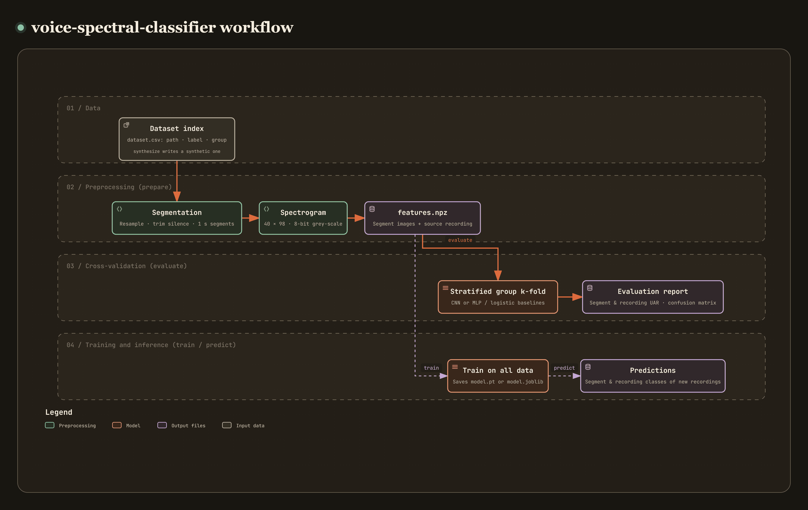

# voice-spectral-classifier

[](https://github.com/recklight/voice-spectral-classifier/actions/workflows/ci.yml)
[](https://www.python.org/downloads/)
[](LICENSE)

English | [繁體中文](README.zh-TW.md)

A research tool for classifying pathological voices from fixed-size spectrograms with a convolutional neural network (CNN).

The Python package `voice_spectral_classifier` and its command-line tool `voice-spectral-classifier` take recordings of sustained vowels, resample them, trim leading and trailing silence and cut them into 1-second segments. Each segment becomes a 40 × 98 grey-scale spectrogram, which a small CNN classifies. Either an MLP or logistic regression can stand in as a baseline, and neither needs PyTorch. Evaluation uses stratified, grouped k-fold cross-validation and reports the unweighted average recall (UAR), a confusion matrix and per-class metrics, both for segments and for whole recordings.

Author: RL

---

## Contents

- [Overview](#overview)
- [Method](#method)
- [Installation](#installation)
- [Quick start](#quick-start)
- [Usage examples](#usage-examples)
- [CLI reference](#cli-reference)
- [Project structure](#project-structure)
- [Data preparation](#data-preparation)
- [Configuration files](#configuration-files)
- [Results and metrics](#results-and-metrics)
- [Known limitations](#known-limitations)
- [Design notes](#design-notes)
- [Development and testing](#development-and-testing)
- [References](#references)
- [License](#license)

---

## Overview

[](https://raw.githack.com/recklight/voice-spectral-classifier/master/docs/workflow.html?theme=dark)

Interactive workflow diagram: [view it online](https://raw.githack.com/recklight/voice-spectral-classifier/master/docs/workflow.html?theme=dark), or open [`docs/workflow.html`](docs/workflow.html) in a browser.

Pathological voices, such as those caused by laryngeal tumors, vocal fold paralysis, nodules or polyps, leave traces in the spectrum: the harmonic structure blurs, breath noise appears at high frequencies, pitch and loudness waver, or subharmonics show up. Turning a short stretch of a sustained vowel into a time-frequency image and handing it to an image classifier is a common way to detect them automatically (Alhussein & Muhammad, 2018); another approach feeds cepstral features to a deep neural network (Fang et al., 2019).

A recording usually yields several segments. By default all of them are used for training and evaluation, and the segment scores of one recording are averaged into a recording-level decision. Cross-validation is grouped by subject, and UAR is the main metric because clinical data are usually imbalanced: always guessing the majority class earns a respectable accuracy, but a UAR of only 1/K for K classes.

Framing, endpoint detection, the mel filterbank, dB conversion and WAV I/O come from [`speechdsp`](https://pypi.org/project/speechdsp/), and so does the definition of UAR; resampling uses SciPy's polyphase filter.

| Stage | What it does | Module |
| --- | --- | --- |
| 1. Dataset index | Reads and validates `dataset.csv` (paths, classes, subject groups), or builds it from `<folder>/<class>/<file>.wav` | `dataset` |
| 2. Segmentation | Reads WAV files, resamples them to one common rate with a polyphase filter, trims leading and trailing silence, cuts fixed-length segments | `segmentation` |
| 3. Spectrogram | Short-time power spectral density, equal-width or mel bands, dB relative to the segment peak, linear quantization to a 40 × 98 8-bit image | `spectrogram` |
| 4. Models | Spectrogram CNN (PyTorch, optional), MLP and logistic regression baselines, class-imbalance handling | `cnn`, `models` |
| 5. Evaluation | Stratified, grouped k-fold cross-validation, metrics at segment and recording level, confusion-matrix figures | `evaluation`, `figures` |
| 6. Pipeline and outputs | The `prepare` / `train` / `predict` high-level functions, run folders, `config.yaml` and `manifest.json` | `pipeline`, `manifest`, `cli` |
| 7. Synthetic data | Synthetic sustained vowels with three voice qualities, for the tests, the examples and the quick start | `synthetic` |

---

## Method

### 1. Resampling, silence trimming and fixed-length segmentation

Each recording is read as mono `float64` with `speechdsp.read_wav` and resampled to `segmentation.sample_rate` (16 kHz by default) with a polyphase anti-aliasing filter (Crochiere & Rabiner, 1983). That way, recordings made at a mix of 44.1 kHz and 48 kHz share the same time and frequency resolution, and a parameter given in milliseconds means the same thing for all of them. Nothing above 8 kHz is used, so 16 kHz is enough: it keeps exactly 0–8 kHz.

Leading and trailing silence can then be removed with two-threshold endpoint detection (Rabiner & Sambur, 1975; `speechdsp.trim_silence`) before the signal is cut into segments of length $L$ with hop $H$. Segment $i$ starts at sample $iH$, and the number of complete segments is

$$n = \left\lfloor \frac{N - L}{H} \right\rfloor + 1 .$$

What remains after the last complete segment is zero-padded and kept if it is at least `min_fraction` × $L$ long, and dropped otherwise. Each segment records its position in the recording (`segment`, counting from 0) and carries the recording path and the subject group `group`.

| Key | Default | Effect |
| --- | --- | --- |
| `segmentation.sample_rate` | `16000` | Every recording is resampled to this rate (Hz) |
| `segmentation.trim_silence` | `true` | Trim leading and trailing silence first |
| `segmentation.segment_s` | `1.0` | Segment length (seconds) |
| `segmentation.hop_s` | `1.0` | Segment hop (seconds); less than `segment_s` gives overlapping segments |
| `segmentation.min_fraction` | `0.5` | A leftover piece must fill at least this fraction of a segment to be zero-padded and kept |
| `segmentation.max_segments` | `null` | At most this many segments per recording (picked evenly; when only one is kept, the middle one); `null` keeps all |

### 2. Short-time power spectral density

A segment is split into frames with `speechdsp.enframe`, multiplied by an analysis window (Hamming by default; Harris, 1978), zero-padded to $N_{\mathrm{FFT}}$ points and passed through a real FFT (Allen, 1977). The one-sided power spectral density of frame $t$ is

$$P_t[k] = \frac{c_k \, |X_t[k]|^2}{f_s \sum_n w[n]^2}, \qquad c_k = \begin{cases} 1 & k = 0 \text{ or Nyquist} \\ 2 & \text{otherwise} \end{cases}$$

Integrated over frequency it equals the variance of the signal (a test checks this on white noise). With the default 25 ms frames and 10 ms hop, a 1-second segment (the usual clip length in keyword-spotting datasets; Warden, 2018) gives exactly $\lfloor (1000 - 25) / 10 \rfloor + 1 = 98$ frames, which is where the 98 columns come from. By default $N_{\mathrm{FFT}}$ is the next power of two at or above the frame length (at 16 kHz a 400-point frame is zero-padded to 512 points).

| Key | Default | Effect |
| --- | --- | --- |
| `spectrogram.frame_ms` | `25.0` | Frame length (ms) |
| `spectrogram.hop_ms` | `10.0` | Frame hop (ms) |
| `spectrogram.n_fft` | `null` | FFT size; `null` is the next power of two at or above the frame length |
| `spectrogram.window` | `hamming` | Window function: `hamming`, `hann`, `blackman` or `boxcar` |

### 3. Band grid and 8-bit quantization

The power spectrum between 0 Hz and `fmax_hz` is pooled into `n_bands` bands:

- `linear`: equal-width bands (40 by default, 200 Hz each). Each FFT bin is weighted by the fraction of its width that falls inside a band, and every row of weights sums to 1, so a band value is a mean power. No row is ever empty, even when a band is narrower than a bin.
- `mel`: the triangular mel filters of `speechdsp.mel_filterbank` (Stevens et al., 1937; Davis & Mermelstein, 1980), with finer resolution at low frequencies.

The bands are then converted to dB relative to the segment's own peak (`speechdsp.power_to_db`) and floored at `top_db`:

$$L = \max\!\left(10 \log_{10} \frac{E}{E_{\max}},\; -\mathrm{top\_db}\right),$$

interpolated linearly along time when the number of frames differs from `n_frames` (with exactly 98 frames there is nothing to interpolate), and finally quantized linearly to grey levels

$$g = \mathrm{round}\!\left(255 \cdot \frac{L + \mathrm{top\_db}}{\mathrm{top\_db}}\right) \in \{0, \dots, 255\}.$$

Row 0 of the image is the lowest band and column 0 the earliest frame. Grey level 255 is the segment's spectral peak, 0 lies `top_db` dB below it, and the mapping in between is linear. One grey level is `top_db`/255 dB (about 0.31 dB by default), so grey values convert back to dB; only what fell below the floor is lost. Nothing in this step is random, so the same signal and settings always give the same image. Because the dB floor is relative to the peak, a recording gives the same image whether it is quiet or loud, and an all-silent segment (zero padding, for example) is all black.

| Key | Default | Effect |
| --- | --- | --- |
| `spectrogram.scale` | `linear` | `linear` or `mel` |
| `spectrogram.n_bands` | `40` | Image rows (number of bands) |
| `spectrogram.n_frames` | `98` | Image columns (number of frames) |
| `spectrogram.fmax_hz` | `8000.0` | Upper edge of the highest band (Hz); must not exceed half the sample rate |
| `spectrogram.top_db` | `80.0` | Dynamic range: grey level 0 sits this many dB below the peak |

### 4. Spectrogram CNN

The input representation follows small-footprint keyword spotting: a time-frequency image with 40 bands, 25 ms frames and a 10 ms hop (Sainath & Parada, 2015), 1 second long (Warden, 2018). The network itself is a stack of small 3 × 3 kernels (Simonyan & Zisserman, 2015): six convolution blocks with "same" padding, each followed by batch normalization (Ioffe & Szegedy, 2015) and a ReLU activation (Nair & Hinton, 2010), with dropout (Srivastava et al., 2014) before the last four blocks.

| Block | Channels | After the block | Output (40 × 98 input) |
| --- | --- | --- | --- |
| 1 | 16 | 2 × 2 max pooling | 16 × 20 × 49 |
| 2 | 32 | 2 × 2 max pooling, one column of padding on each side | 32 × 10 × 25 |
| 3 | 64 | — | 64 × 10 × 25 |
| 4 | 64 | 2 × 2 max pooling, one column of padding on each side | 64 × 5 × 13 |
| 5 | 64 | — | 64 × 5 × 13 |
| 6 | 64 | Maximum over the whole time axis | 64 × 5 × 1 |

The remaining 320 values feed a fully connected layer and a softmax, and the network is trained with cross-entropy loss and Adam (LeCun et al., 1998; Kingma & Ba, 2015). It has 135,651 trainable parameters (`parameter_count(3)`). Because the last block takes a global maximum along time, the input size of the fully connected layer does not depend on the number of columns, and the same architecture works for any `spectrogram.n_frames`; a trained model only accepts the image size it was trained on. Inputs are divided by 255, and the per-pixel mean image of the training data is subtracted. That mean image is registered as a buffer of the network, so it is stored in the `state_dict` together with the weights and applied automatically at inference.

Every epoch reshuffles the training data with a seeded random generator, and the last, partial batch is kept; `torch.manual_seed(seed)` fixes the initial weights. With `model.class_weight = balanced`, class $c$ gets the cross-entropy weight $w_c = N / (K N_c)$, where $N$ is the number of training segments, $K$ the number of classes and $N_c$ the number of segments in that class. The defaults are a learning rate of $10^{-3}$ and 100 epochs; to try other learning rates, override the default with `--set model.learning_rate=...`.

| Key | Default | Effect |
| --- | --- | --- |
| `model.name` | `cnn` | `cnn` (needs the `dl` extra), `mlp` or `logistic` |
| `model.n_epochs` | `100` | Training epochs of the CNN; for the MLP an upper limit, with an early stop once the training loss improves by less than $10^{-4}$ for 10 epochs in a row |
| `model.learning_rate` | `0.001` | Adam step size (CNN and MLP) |
| `model.batch_size` | `60` | Mini-batch size (CNN and MLP) |
| `model.weight_decay` | `0.0001` | L2 penalty: Adam weight decay for the CNN, `alpha` for the MLP |
| `model.dropout` | `0.2` | Dropout probability before the last four convolution blocks |
| `model.device` | `cpu` | `cpu` or `cuda` |

### 5. Baselines and class imbalance

Without PyTorch the whole workflow still runs on scikit-learn models, and they double as the baselines the CNN is compared against. The 40 × 98 image is flattened into a 3,920-dimensional vector, standardized (optionally projected with PCA) and passed to a multilayer perceptron trained by backpropagation (MLP; Rumelhart et al., 1986) or to multinomial logistic regression. Every step that learns parameters from data sits in one `Pipeline`, so cross-validation fits it on the training folds only.

For logistic regression, `class_weight = balanced` means a weighted loss. The MLP does not support class weights, so inside the training folds the segments of the smaller classes are resampled at random with replacement until every class is as large as the largest one; inference is not affected.

| Key | Default | Effect |
| --- | --- | --- |
| `model.class_weight` | `balanced` | `balanced` or `null` |
| `model.hidden_units` | `[128]` | MLP hidden layer sizes |
| `model.n_components` | `null` | Number of principal components to project onto first; `null` means no projection |
| `model.logistic_c` | `1.0` | Inverse regularization strength of logistic regression |

### 6. Stratified grouped cross-validation and recording-level pooling

The folds come from `StratifiedGroupKFold(n_splits, shuffle=True, random_state=seed)` (Kohavi, 1995). Each fold keeps the class proportions, and all segments of one `group` (a subject, or the recording itself when the index has no `group` column) always land in the same fold. Every fold builds a new model and fits it on the training folds only, so each segment gets exactly one out-of-fold prediction.

The main metric is UAR (Schuller et al., 2009), the mean of the per-class recalls:

$$\mathrm{UAR} = \frac{1}{K} \sum_{c=1}^{K} \frac{\mathrm{TP}_c}{\mathrm{TP}_c + \mathrm{FN}_c}.$$

Predicting the majority class every time does not inflate it; on a three-class problem, random guessing gives a UAR of about 1/3. Accuracy, macro F1 and one-vs-rest macro ROC-AUC are reported as well, along with a confusion matrix of the pooled out-of-fold predictions and, for each class, recall (sensitivity), specificity, precision, F1 and the number of samples. Per-fold metrics are summarized by their mean and sample standard deviation (`ddof=1`).

The recording-level decision averages the class probabilities of all segments of a recording and picks the most probable class:

$$\bar{p}_r(c) = \frac{1}{|S_r|} \sum_{s \in S_r} p_s(c), \qquad \hat{y}_r = \arg\max_c \bar{p}_r(c).$$

| Key | Default | Effect |
| --- | --- | --- |
| `evaluation.n_splits` | `5` | Number of cross-validation folds |
| `seed` | `0` | Master seed: folds, model initialization, oversampling and synthetic data all follow from it |

### 7. Synthetic data

The synthetic data used by the `synthesize` command and the tests are sustained vowels made from a harmonic source and the four formants of /a/, in three voice qualities:

| Class | How it is generated | What it leaves on the spectrogram |
| --- | --- | --- |
| `modal` | Steady harmonics, moderate spectral tilt, very little noise | Clear horizontal harmonic stripes |
| `breathy` | Steeper spectral tilt (weak upper harmonics), strong breath noise above 2 kHz | The whole high-frequency region lights up |
| `rough` | 4–6 Hz tremor of pitch and loudness, subharmonics at 0.5 and 1.5 times the fundamental | Periodic ripples along time, extra spectral lines |

I picked these three qualities because each leaves a different trace on the spectrogram. They are stand-in signals and do not model any clinical condition. Every synthetic speaker has their own fundamental frequency, formant scaling and "severity" (`synthetic.severity_range`; 0 gives a modal voice, 1 the most pronounced quality), and mild speakers overlap with modal ones, so the classification is not trivial. A speaker's recordings share these parameters (only the fundamental varies, within ±3% for each recording), so cross-validation that did not group by speaker would put voices already heard in training into the test fold. Recordings alternate between sample rates (22,050 and 24,000 Hz by default) and start and end with a short stretch of near-silence, so the resampling and silence-trimming code actually gets exercised. The default class sizes are 8 / 10 / 20 speakers, imbalanced on purpose. All randomness comes from one generator, so the same seed writes byte-identical files.

| Key | Default | Effect |
| --- | --- | --- |
| `synthetic.class_names` | `[breathy, modal, rough]` | Voice qualities to synthesize (at least two) |
| `synthetic.n_speakers_per_class` | `[8, 10, 20]` | Synthetic speakers per class, in the order of `class_names` |
| `synthetic.n_recordings_per_speaker` | `2` | Recordings per speaker (a speaker's recordings always share a fold) |
| `synthetic.severity_range` | `[0.2, 1.0]` | Severity range of non-modal speakers: 0 gives a modal voice, 1 the most pronounced quality |
| `synthetic.duration_s` | `2.5` | Length of the voiced part (seconds) |
| `synthetic.silence_s` | `0.25` | Length of the near-silent parts at the start and end (seconds) |
| `synthetic.sample_rates` | `[22050, 24000]` | Sample rates the recordings alternate between (Hz) |

---

## Installation

Requires Python 3.10 or later.

```bash
git clone https://github.com/recklight/voice-spectral-classifier.git
cd voice-spectral-classifier
python -m venv .venv
# Windows: .venv\Scripts\activate    Linux/macOS: source .venv/bin/activate
pip install -e .                 # core (also installs speechdsp from PyPI)
pip install -e ".[dl]"           # PyTorch models (optional)
pip install -e ".[dev]"          # development tools: pytest, ruff
```

Only the CNN needs PyTorch. Without the `dl` extra you can still generate synthetic data, preprocess, cross-validate, train and predict with the MLP and logistic regression, and draw the figures. The default `model.name` is `cnn`, so running without PyTorch gives an error that tells you to run `pip install -e ".[dl]"` in the project folder (or plain `pip install torch`). To do without PyTorch, add `--set model.name=mlp`; `configs/quick_demo.yaml` already sets it.

The package also runs without being installed: from the project folder, `PYTHONPATH=src python -m voice_spectral_classifier --help`.

---

## Quick start

No data needed; the commands below start by generating a synthetic dataset.

```bash
# 1. Generate a synthetic dataset
voice-spectral-classifier synthesize --config configs/quick_demo.yaml --out data/synthetic
# 2. Prepare model inputs from the dataset index
voice-spectral-classifier prepare --config configs/quick_demo.yaml --out outputs/demo/prepare
# 3. Cross-validate
voice-spectral-classifier evaluate outputs/demo/prepare/features.npz --config configs/quick_demo.yaml --out outputs/demo/evaluate
# 4. Train on all the data
voice-spectral-classifier train outputs/demo/prepare/features.npz --config configs/quick_demo.yaml --out outputs/demo/train
# 5. Predict on a new input file
voice-spectral-classifier predict data/synthetic/rough/rough_000.wav --model outputs/demo/train/model.joblib --out outputs/demo/predict
```

Or run the whole workflow at once: `python examples/end_to_end_synthetic.py`.

> This synthetic set has only 18 recordings and is there to check that every command runs; the scores it produces say nothing about performance on real data.

---

## Usage examples

### CLI

```bash
# 1. Build the dataset index from a <folder>/<class>/<file>.wav layout (the group column can be edited by hand afterwards)
voice-spectral-classifier index data/voices
# 2. Segment and compute spectrograms, here with mel bands
voice-spectral-classifier prepare --dataset data/voices/dataset.csv --set spectrogram.scale=mel --out outputs/voices/prepare
# 3. 5-fold cross-validation of the CNN (needs the dl extra); feature settings must match prepare
voice-spectral-classifier evaluate outputs/voices/prepare/features.npz --set spectrogram.scale=mel --seed 1 --out outputs/voices/evaluate
# 4. For comparison, switch to the MLP baseline and turn class balancing off
voice-spectral-classifier evaluate outputs/voices/prepare/features.npz --set spectrogram.scale=mel --set model.name=mlp --set model.class_weight=null --out outputs/voices/mlp
# 5. Train on all the data and save the model
voice-spectral-classifier train outputs/voices/prepare/features.npz --set spectrogram.scale=mel --out outputs/voices/train
# 6. Predict on new recordings: writes per-segment and per-recording results
voice-spectral-classifier predict new/visit_01.wav new/visit_02.wav --model outputs/voices/train/model.pt --out outputs/voices/predict
```

`prepare`, `evaluate` and `train` above each need their own `--set spectrogram.scale=mel`. Settings that stay fixed can go into a YAML file of your own (for example a `configs/my_study.yaml` that lists only the keys differing from the defaults), passed with `--config`.

### Python API

```python
import numpy as np

from voice_spectral_classifier import (
    Config,
    cross_validate,
    load_model,
    predict_inputs,
    prepare_features,
    save_model,
    spectrogram_image,
    train_model,
    write_synthetic_dataset,
)

# 1. Low-level function: the 40 × 98 spectrogram of a 1.1 kHz sine; the brightest row is band 5, 1000–1200 Hz
t = np.arange(16_000) / 16_000
image = spectrogram_image(np.sin(2 * np.pi * 1100 * t), 16_000)
print(image.shape, image.dtype, image.mean(axis=1).argmax())  # (40, 98) uint8 5

# 2. Configuration: read the quick-demo settings, then override dotted keys (mel bands and logistic regression)
config = Config.from_yaml("configs/quick_demo.yaml").override(
    {"spectrogram.scale": "mel", "model.name": "logistic"}
)

# 3. Synthetic data → segment images
index = write_synthetic_dataset("data/synthetic", config.synthetic, rng=config.seed)
features = prepare_features(index, config)
print(features.n_items, features.image_shape)  # 36 (40, 98)

# 4. Grouped cross-validation: segment-level and recording-level UAR (mean ± sample standard deviation over 3 folds)
result = cross_validate(features, config)
for level in (result.metrics, result.metrics["recordings"]):
    uar = level["summary"]["uar"]
    print(f"{uar['mean']:.3f} +/- {uar['std']:.3f}")  # 0.722 +/- 0.096, then 0.778 +/- 0.096
print(result.predictions.columns.tolist())  # path, segment, group, fold, label, predicted, score_<class>

# 5. Train, save, load back and predict
model_path = save_model("outputs/model.joblib", train_model(features, config), config)
bundle = load_model(model_path)
table = predict_inputs(["data/synthetic/rough/rough_000.wav"], bundle)
print(table[["segment", "predicted"]])  # one row per segment
```

### Example scripts

| Script | What it shows | Run time |
| --- | --- | --- |
| `examples/end_to_end_synthetic.py` | Synthetic data → spectrograms → cross-validation → training and saving → loading back and predicting, all through the public API | About 20 s (`--quick` about 3 s) |
| `examples/compare_spectrogram_scales.py` | Cross-validates logistic regression and the MLP (plus the CNN when PyTorch is installed) on `linear` and on `mel` spectrograms of the same data, and writes a comparison table and bar chart | About 30 s (`--quick` about 3 s) |
| `examples/aggregate_segment_scores.py` | One segment per recording against all segments, and how segment-level and recording-level scores differ; on the default data, one segment gives a UAR of 0.795 ± 0.109 and all segments 0.833 ± 0.054 (0.837 ± 0.099 at recording level) | About 25 s (`--quick` about 3 s) |

Every script accepts `--out`, `--seed` and `--quick`, and writes to `examples/output/<script name>/` by default.

---

## CLI reference

| Command | Purpose | Main input | Main output |
| --- | --- | --- | --- |
| `synthesize` | Writes a synthetic dataset in the same format as real data | Configuration | `<out>/<class>/<class>_<NNN>.wav`, `dataset.csv` |
| `index` | Builds a dataset index from `<folder>/<class>/<file>.wav` | Folder | `<folder>/dataset.csv` |
| `prepare` | Reads the dataset index, segments the recordings, computes spectrograms | `dataset.csv` | `features.npz`, `items.csv`, `class_spectrograms.*` |
| `evaluate` | Stratified, grouped k-fold cross-validation | `features.npz` | `metrics.json`, `folds.csv`, `predictions.csv`, `recording_predictions.csv`, confusion-matrix figures |
| `train` | Trains once on all segments and saves the model | `features.npz` | `model.pt` (CNN) or `model.joblib` |
| `predict` | Classifies new recordings with a model file, using only the settings stored in it | WAV files, model file | `predictions.csv`, `recording_predictions.csv` |

| Option | Commands | Description |
| --- | --- | --- |
| `--log-level LEVEL` | Global (before the subcommand) | `DEBUG`, `INFO` (default), `WARNING` or `ERROR`; log output goes to stderr |
| `--version` | Global | Show the version and exit |
| `--config/-c PATH` | `synthesize`, `prepare`, `evaluate`, `train` | YAML configuration file; the defaults apply when it is not given |
| `--set/-s KEY=VALUE` | Same as above | Override one setting, for example `--set model.name=mlp`; repeatable |
| `--seed INT` | `synthesize`, `evaluate`, `train` | Same as `--set seed=INT` |
| `--dataset/-d PATH` | `prepare` | Same as `--set data.dataset=PATH` |
| `--out/-o PATH` | `synthesize`, `prepare`, `evaluate`, `train`, `predict` | Output folder, created if it does not exist; when not given, a `<command>_<UTC time>` folder under `output.root` (`synthesize` defaults to `data/synthetic`). `index` has no such option and always writes `<folder>/dataset.csv` |
| `--model/-m PATH` | `predict` | Model file written by `train` (required) |
| `--figures/--no-figures` | `prepare` | Whether to plot the mean spectrogram of each class (on by default) |

Every command except `index` also writes `config.yaml` and `manifest.json` to the output folder, so you can later look up which settings and input files a run used.

Exit codes: `0` means success; `2` means a problem with the input or the configuration (a single `error: ...` line is printed; add `--log-level DEBUG` to see the full traceback); `1` means an interruption or a bug in the program itself.

---

## Project structure

```text
voice-spectral-classifier/
├── .github/
│   ├── ISSUE_TEMPLATE/
│   │   ├── bug_report.yml               # bug report form
│   │   ├── config.yml                   # turns off blank issues
│   │   └── feature_request.yml          # feature request form
│   └── workflows/
│       └── ci.yml                       # lint, 3.10 syntax gate, Linux/Windows × Python 3.10–3.13, oldest dependencies, PyTorch
├── configs/
│   ├── default.yaml                     # identical to Config(), with a comment on every key
│   └── quick_demo.yaml                  # small synthetic set and MLP, done in seconds
├── data/
│   └── .gitkeep                         # default place for data; its contents stay out of git
├── outputs/
│   └── .gitkeep                         # default root of the run folders; its contents stay out of git
├── docs/
│   ├── images/workflow.png              # workflow diagram shown in README.md
│   ├── images/workflow.zh-TW.png        # the same diagram in Traditional Chinese
│   ├── workflow.html                    # interactive workflow diagram (open in a browser)
│   └── workflow.zh-TW.html              # the interactive diagram in Traditional Chinese
├── examples/
│   ├── end_to_end_synthetic.py          # end-to-end workflow
│   ├── compare_spectrogram_scales.py    # linear vs mel spectrograms across the models
│   └── aggregate_segment_scores.py      # segment-level vs recording-level scores
├── src/
│   └── voice_spectral_classifier/
│       ├── __init__.py                  # public API
│       ├── __main__.py                  # python -m voice_spectral_classifier
│       ├── py.typed                     # marks the package as typed
│       ├── cli.py                       # typer command line
│       ├── config.py                    # configuration dataclasses, YAML reading and writing
│       ├── errors.py                    # exception classes
│       ├── logging_utils.py             # logging setup
│       ├── manifest.py                  # run folders and manifest.json
│       ├── dataset.py                   # dataset.csv and features.npz
│       ├── synthetic.py                 # synthetic sustained vowels
│       ├── segmentation.py              # resampling, silence trimming, fixed-length segmentation
│       ├── spectrogram.py               # power spectral density, band grid, 8-bit quantization
│       ├── cnn.py                       # spectrogram CNN (imports PyTorch lazily)
│       ├── models.py                    # model registry, class balancing, model files
│       ├── pipeline.py                  # prepare/train/predict high-level functions
│       ├── evaluation.py                # grouped cross-validation and metrics
│       └── figures.py                   # confusion matrices, mean class spectrograms and their tables
├── tests/                               # tests for every module, plus CLI, example, 3.10 compatibility and documentation checks
├── .gitattributes
├── .gitignore
├── CHANGELOG.md
├── CITATION.cff
├── CONTRIBUTING.md
├── LICENSE
├── README.md                            # English
├── README.zh-TW.md                      # Traditional Chinese
└── pyproject.toml
```

---

## Data preparation

**No data comes with this project.** The repository holds no recordings, spectrogram images or model files, and the tests and examples use only data the code synthesizes. Prepare your own recordings and point `data.dataset` (or `--dataset`) at your dataset index.

### 1. Dataset index (dataset.csv)

| Column | Required | Description |
| --- | --- | --- |
| `path` | Yes | WAV file path, relative to the folder that holds `dataset.csv`, separated by `/` (`\` is accepted too) |
| `label` | Yes | Class name, for example `neoplasm`, `phonotrauma`, `palsy`; classes are always in alphabetical order |
| `group` | No | Subject code. All recordings of one subject always fall in the same fold; without this column, each recording is a group of its own |

```csv
path,label,group
neoplasm/case_0001.wav,neoplasm,case_0001
palsy/case_0002_a.wav,palsy,case_0002
palsy/case_0002_b.wav,palsy,case_0002
phonotrauma/case_0003.wav,phonotrauma,case_0003
```

File names carry no meaning; labels and groups are read from the columns only. If the recordings already sit in one sub-folder per class, `voice-spectral-classifier index <folder>` writes a `dataset.csv` (one group per recording); then edit the `group` column as needed. If files listed in the index do not exist, the program lists the first 5 missing paths and stops.

### 2. File format

| Item | Requirement and handling |
| --- | --- |
| Container | RIFF/WAVE; 8-, 16- or 32-bit integer or floating-point PCM |
| Channels | Multichannel audio is averaged to mono |
| Sample rate | Any; always resampled to `segmentation.sample_rate` (16 kHz by default) |
| Length | At least `min_fraction` × `segment_s` (0.5 seconds by default) of voiced signal; shorter recordings are skipped with a logged warning |
| Values | A single NaN or infinite sample in a floating-point WAV stops the program, and the error names the file |
| Content | Sustained vowels (such as /a/) work best; the pipeline does not split continuous speech into words |

### 3. Public dataset

The FEMH Voice Data Challenge 2018, held at IEEE BigData 2018, provides sustained-vowel recordings in classes such as neoplasm, phonotrauma and vocal palsy; access has to be requested from the organizers. Once you have it, build a `dataset.csv` in the format above and the pipeline runs on it as is. This project neither includes nor distributes that dataset.

---

## Configuration files

- `configs/default.yaml`: identical to `Config()`, with a comment on every key; copy it as a starting point.
- `configs/quick_demo.yaml`: lists only the keys that differ from the defaults (a small synthetic set, MLP, 3 folds), so the quick start finishes in seconds; `data.dataset` points to `data/synthetic/dataset.csv`.

No configuration file is loaded automatically: without `--config`, the defaults apply. Relative paths in a configuration are resolved against the current working directory.

| Section | Key fields | Description |
| --- | --- | --- |
| (top level) | `seed` | Master seed |
| `data` | `dataset` | Dataset index (the default is the placeholder `data/dataset.csv`) |
| `synthetic` | `class_names`, `n_speakers_per_class`, `n_recordings_per_speaker`, `severity_range`, `duration_s`, `silence_s`, `sample_rates` | Size and generation parameters of the synthetic data |
| `segmentation` | `sample_rate`, `trim_silence`, `segment_s`, `hop_s`, `min_fraction`, `max_segments` | Resampling, silence trimming and segmentation |
| `spectrogram` | `scale`, `n_bands`, `n_frames`, `frame_ms`, `hop_ms`, `n_fft`, `window`, `fmax_hz`, `top_db` | Spectrograms |
| `model` | `name`, `n_epochs`, `learning_rate`, `batch_size`, `weight_decay`, `class_weight`, `dropout`, `hidden_units`, `n_components`, `logistic_c`, `device` | Model and training |
| `evaluation` | `n_splits` | Number of cross-validation folds |
| `output` | `root`, `figure_format`, `dpi` | Where run folders go and the figure format |

`segmentation` and `spectrogram` determine what `prepare` produces and are stored in `features.npz`. When `evaluate` or `train` reads the file and these two sections differ from the current configuration, it stops with an error, so a model is never trained on features made with other settings. `predict` uses only the settings in the model file.

Unknown keys, wrong types and non-finite numbers (such as `.inf`) are errors. For an unknown key, the message also lists the valid keys, for example:

```text
$ voice-spectral-classifier prepare --set spectrogram.n_band=20
error: unknown configuration key 'spectrogram.n_band'; valid keys here are ['fmax_hz', 'frame_ms', 'hop_ms', 'n_bands', 'n_fft', 'n_frames', 'scale', 'top_db', 'window']
```

---

## Results and metrics

The run folder that one `evaluate` call writes:

```text
outputs/demo/evaluate/
├── config.yaml                      # the full configuration actually used
├── manifest.json                    # command, time, versions, SHA-256 of the input files, seed
├── metrics.json                     # per-fold, summary and pooled metrics (segment and recording level)
├── folds.csv                        # one row per fold
├── predictions.csv                  # one out-of-fold prediction per segment
├── recording_predictions.csv        # one per recording (mean of the segment probabilities)
├── confusion_matrix.png             # segment-level confusion matrix
├── confusion_matrix.csv             # the numbers behind the same figure
├── recording_confusion_matrix.png   # recording-level confusion matrix
└── recording_confusion_matrix.csv
```

| File | Contents |
| --- | --- |
| `metrics.json` | `task`, `n_items`, `n_splits`, `seed`, `folds`, `summary` (`mean` and `std` of each metric), `pooled` (with `classes`, `confusion_matrix`, `per_class`), `recordings` (the same structure, per recording) |
| `folds.csv` | `fold`, `n_train`, `n_test`, `uar`, `accuracy`, `f1_macro`, `roc_auc_ovr` |
| `predictions.csv` | `path`, `segment`, `group`, `fold`, `label`, `predicted`, `score_<class>`, rows in the same order as `items.csv` |
| `recording_predictions.csv` | `path`, `group`, `fold`, `label`, `predicted`, `score_<class>` |
| `confusion_matrix.csv` | `label` (true class), `predicted`, `count`, `fraction` (share of that true class) |

| Metric | Definition | Why it is reported |
| --- | --- | --- |
| UAR | Mean of the per-class recalls | The main metric under class imbalance; always guessing the majority class gets only $1/K$ |
| accuracy | Fraction of correct predictions | Intuitive, but dominated by the majority class; for reference only |
| `f1_macro` | Mean of the per-class F1 scores | Reflects precision and recall together |
| `roc_auc_ovr` | Mean of each class's ROC-AUC against the rest | Independent of the decision threshold, measures how well the probabilities rank; `null` when a test fold lacks a class |
| Per-class recall / specificity | Share of the class that is found / share of the other classes not mistaken for it | The clinical sensitivity and specificity (one-vs-rest) |
| Confusion matrix | Rows are true classes, columns predicted classes | Shows which two classes the errors pile up between |

All numbers below come from running these commands on synthetic data (Windows 11, Python 3.13, scikit-learn 1.7, NumPy 2.3; the CNN on the CPU build of PyTorch 2.14) and are given as mean ± sample standard deviation, `ddof=1`. On another operating system or with other package versions, the last digits may differ slightly.

Quick start results (`quick_demo.yaml`: 18 recordings, 36 segments, MLP, 3 folds):

```bash
voice-spectral-classifier synthesize --config configs/quick_demo.yaml --out data/synthetic
voice-spectral-classifier prepare --config configs/quick_demo.yaml --out outputs/demo/prepare
voice-spectral-classifier evaluate outputs/demo/prepare/features.npz --config configs/quick_demo.yaml --out outputs/demo/evaluate
```

| Level | Count | UAR | accuracy | macro F1 | ROC-AUC (OvR) |
| --- | --- | --- | --- | --- | --- |
| Segment | 36 | 0.889 ± 0.096 | 0.889 ± 0.096 | 0.888 ± 0.098 | 0.927 ± 0.079 |
| Recording | 18 | 0.889 ± 0.096 | 0.889 ± 0.096 | 0.888 ± 0.098 | 0.934 ± 0.082 |

Pooled segment-level confusion matrix (`confusion_matrix.csv`) and per-class metrics:

| True \ predicted | breathy | modal | rough | recall | specificity |
| --- | --- | --- | --- | --- | --- |
| breathy | 10 | 0 | 0 | 1.000 | 1.000 |
| modal | 0 | 8 | 2 | 0.800 | 0.923 |
| rough | 0 | 2 | 14 | 0.875 | 0.900 |

Band scales, models and class balancing compared on the default-size synthetic data (38 speakers, 76 recordings, 228 segments, 5 folds):

```bash
voice-spectral-classifier synthesize --out data/synthetic_full
voice-spectral-classifier prepare --dataset data/synthetic_full/dataset.csv --out outputs/full/linear
voice-spectral-classifier prepare --dataset data/synthetic_full/dataset.csv --set spectrogram.scale=mel --out outputs/full/mel
voice-spectral-classifier evaluate outputs/full/linear/features.npz --set model.name=cnn --out outputs/full/linear_cnn
voice-spectral-classifier evaluate outputs/full/linear/features.npz --set model.name=logistic --out outputs/full/linear_logistic
voice-spectral-classifier evaluate outputs/full/linear/features.npz --set model.name=mlp --out outputs/full/linear_mlp
voice-spectral-classifier evaluate outputs/full/mel/features.npz --set spectrogram.scale=mel --set model.name=cnn --out outputs/full/mel_cnn
voice-spectral-classifier evaluate outputs/full/mel/features.npz --set spectrogram.scale=mel --set model.name=logistic --out outputs/full/mel_logistic
voice-spectral-classifier evaluate outputs/full/mel/features.npz --set spectrogram.scale=mel --set model.name=mlp --out outputs/full/mel_mlp
voice-spectral-classifier evaluate outputs/full/linear/features.npz --set model.name=mlp --set model.class_weight=null --out outputs/full/linear_mlp_unweighted
```

| Spectrogram | Model | `class_weight` | UAR (segment) | accuracy (segment) | UAR (recording) |
| --- | --- | --- | --- | --- | --- |
| `linear` | `cnn` | `balanced` | 0.843 ± 0.080 | 0.807 ± 0.100 | 0.834 ± 0.099 |
| `linear` | `logistic` | `balanced` | 0.933 ± 0.070 | 0.921 ± 0.072 | 0.933 ± 0.070 |
| `linear` | `mlp` | `balanced` | 0.833 ± 0.054 | 0.826 ± 0.084 | 0.837 ± 0.099 |
| `linear` | `mlp` | `null` | 0.827 ± 0.070 | 0.826 ± 0.091 | 0.820 ± 0.066 |
| `mel` | `cnn` | `balanced` | 0.945 ± 0.069 | 0.938 ± 0.062 | 0.945 ± 0.069 |
| `mel` | `logistic` | `balanced` | 0.841 ± 0.130 | 0.846 ± 0.096 | 0.838 ± 0.134 |
| `mel` | `mlp` | `balanced` | 0.827 ± 0.112 | 0.840 ± 0.099 | 0.827 ± 0.118 |

In this synthetic data the classes differ mainly above 2 kHz (breath noise) and in the detail around the fundamental (subharmonics). Logistic regression does clearly better with `linear` (0.933 vs 0.841), possibly because equal-width bands resolve the high frequencies better than mel bands do; the MLP scores about the same with either. The CNN does better with `mel` (0.945 vs 0.843), which is also the highest UAR in the table. No scale is better for every model, and real data may lead to a different conclusion, so I kept both scales. The two CNN rows need the `dl` extra.

---

## Known limitations

- The synthetic vowels only confirm that every step works as intended; the scores above cannot be used to estimate accuracy on clinical data. Evaluate on your own data with grouped cross-validation.
- This is research code. It has not been clinically validated and must not be used for diagnosis.
- Only load model files from sources you trust. `model.joblib` is a pickle and can run arbitrary code when it is loaded; `model.pt` is read with `weights_only=True`, which is less risky, but the same rule applies: use only files you trained yourself.
- With few subjects, `StratifiedGroupKFold` does not guarantee every class in every fold. A fold that lacks a class records its ROC-AUC as `null`, and the summary averages only the folds where it is defined. UAR averages only the classes that actually occur in that fold (the definition in `speechdsp.uar`), while macro F1 still counts a class that was predicted but does not occur. A warning is logged when a class has fewer subjects than there are folds; add data or lower `evaluation.n_splits` in that case.
- Probabilities are not calibrated. The softmax outputs of the MLP and the CNN are often overconfident, and the recording-level average is taken over the same uncalibrated probabilities; calibrate them separately if you need risk scores.
- Only sustained vowels are handled, and segments are not aligned by speech content; continuous speech needs sentence or phoneme segmentation first.
- Endpoint detection estimates the noise from the beginning of the recording. When voicing starts right at the beginning, the detector keeps the whole recording; for clips already cut to 1 second, set `segmentation.trim_silence=false` so they are not shortened.

---

## Design notes

### Evaluation

- The `group` column keeps all segments of one subject (or one recording) in a single fold; when the same person's voice turns up in both the training and the test folds, the scores come out too high. Every row of `predictions.csv` has its fold, true label and prediction, so any single prediction can be checked afterwards.
- Folds, initial weights, the shuffle order of every epoch, oversampling and synthetic data are all set by `seed`. Rerunning with the same seed in the same environment gives byte-identical CSV files, `metrics.json` and `features.npz` (the tests compare them; `manifest.json` records the run time, so it differs every time).

### Signal processing and input representation

- Every segment carries its recording path and position, and the recording-level scores come from grouping the segments on that path. When `max_segments` keeps only some segments, the position still refers to the segment's place among all segments of the recording.
- `linear` and `mel` differ only in the band pooling matrix and share the rest of the analysis, which is what makes the comparison fair. With the same window and frame settings, the mel version stays within one grey level of `speechdsp.spectrogram_image` (a test compares them).

### Models and data flow

- The CNN logs its training loss at INFO every 10 epochs (and after the last one), so a poor learning rate or epoch count shows up in the log.
- Model files are saved together with the full configuration: scikit-learn models as `model.joblib`, the CNN as a `model.pt` that holds only tensors and basic types. `predict` segments the recordings and computes the spectrograms using only the settings in the model file, so training and inference go through the same preprocessing. A CNN trained on a GPU and moved to a machine without CUDA logs a warning and runs inference on the CPU.
- Labels and groups come only from the `label` and `group` columns of `dataset.csv` and are never parsed from file names, so the file names need not carry any label or identity information. Classes are sorted alphabetically, one per distinct name in the `label` column; however the index rows are ordered, the class indices, the confusion matrix and the `score_<class>` columns always follow that alphabetical order. Recording paths are relative to the folder holding `dataset.csv`, so the index needs no change when the whole folder moves or the commands run from another working directory.
- Each run writes its output into one folder with fixed file names, next to that run's `config.yaml` and `manifest.json`; comparing two runs means comparing two folders.
- When something is wrong with the data (a missing column, a missing file, a WAV that cannot be decoded or contains NaN, feature settings that do not match `prepare`), the error is a single line naming the file, column or setting, so there is no traceback to dig through; recordings that are too short are skipped with a logged warning.

---

## Development and testing

```bash
pip install -e ".[dev]"
python -m pytest -q                 # all tests, doctests included
python -m ruff check .
python -m ruff format --check .
# Python 3.10 syntax gate (runs on any Python version)
python -c "import ast,pathlib; [ast.parse(p.read_text(encoding='utf-8'), str(p), feature_version=(3, 10)) for p in pathlib.Path('.').rglob('*.py') if not {'.venv', 'build', 'dist', '__pycache__'} & set(p.parts)]"
```

Besides the functional tests of each module, two tests check the project itself:

- `tests/test_python310_compat.py` parses every file with Python 3.10 syntax and scans for standard-library names that only exist from 3.11 on, names that are incompatible between NumPy 1.x and 2.x, and APIs newer than the declared minimum dependency versions. It also checks that `import voice_spectral_classifier` and the command line do not load optional packages such as PyTorch.
- `tests/test_documentation.py` checks the wording of the docs (Traditional characters and Taiwan usage in the Chinese text) and the section order of both READMEs, and catches local paths or e-mail addresses written into a file by accident.

The tests also run the three example scripts once each with `--quick`.

The CNN tests need PyTorch. With the `dl` extra installed (the CPU build is enough), they train and predict for real on the local machine; without it they are skipped. CI runs Python 3.10–3.13 on Linux and Windows, plus one job on the oldest dependency versions (all of these minimums install on Python 3.10) and one job that installs the CPU build of PyTorch for the CNN tests.

---

## References

### Signal analysis

- J. B. Allen, "Short term spectral analysis, synthesis, and modification by discrete Fourier transform," *IEEE Transactions on Acoustics, Speech, and Signal Processing*, vol. 25, no. 3, pp. 235–238, 1977.
- F. J. Harris, "On the use of windows for harmonic analysis with the discrete Fourier transform," *Proceedings of the IEEE*, vol. 66, no. 1, pp. 51–83, 1978.
- S. S. Stevens, J. Volkmann, and E. B. Newman, "A scale for the measurement of the psychological magnitude pitch," *The Journal of the Acoustical Society of America*, vol. 8, no. 3, pp. 185–190, 1937.
- S. B. Davis and P. Mermelstein, "Comparison of parametric representations for monosyllabic word recognition in continuously spoken sentences," *IEEE Transactions on Acoustics, Speech, and Signal Processing*, vol. 28, no. 4, pp. 357–366, 1980.
- L. R. Rabiner and M. R. Sambur, "An algorithm for determining the endpoints of isolated utterances," *Bell System Technical Journal*, vol. 54, no. 2, pp. 297–315, 1975.
- R. E. Crochiere and L. R. Rabiner, *Multirate Digital Signal Processing*. Englewood Cliffs, NJ, USA: Prentice-Hall, 1983.

### Neural networks and training

- Y. LeCun, L. Bottou, Y. Bengio, and P. Haffner, "Gradient-based learning applied to document recognition," *Proceedings of the IEEE*, vol. 86, no. 11, pp. 2278–2324, 1998.
- T. N. Sainath and C. Parada, "Convolutional neural networks for small-footprint keyword spotting," in *Proc. Interspeech 2015*, 2015, pp. 1478–1482.
- K. Simonyan and A. Zisserman, "Very deep convolutional networks for large-scale image recognition," in *Proc. 3rd International Conference on Learning Representations (ICLR)*, 2015, arXiv:1409.1556.
- S. Ioffe and C. Szegedy, "Batch normalization: Accelerating deep network training by reducing internal covariate shift," in *Proc. 32nd International Conference on Machine Learning (ICML)*, 2015, pp. 448–456.
- N. Srivastava, G. Hinton, A. Krizhevsky, I. Sutskever, and R. Salakhutdinov, "Dropout: A simple way to prevent neural networks from overfitting," *Journal of Machine Learning Research*, vol. 15, pp. 1929–1958, 2014.
- V. Nair and G. E. Hinton, "Rectified linear units improve restricted Boltzmann machines," in *Proc. 27th International Conference on Machine Learning (ICML)*, 2010, pp. 807–814.
- D. P. Kingma and J. Ba, "Adam: A method for stochastic optimization," in *Proc. 3rd International Conference on Learning Representations (ICLR)*, 2015, arXiv:1412.6980.
- D. E. Rumelhart, G. E. Hinton, and R. J. Williams, "Learning representations by back-propagating errors," *Nature*, vol. 323, pp. 533–536, 1986.

### Classification and evaluation

- R. Kohavi, "A study of cross-validation and bootstrap for accuracy estimation and model selection," in *Proc. 14th International Joint Conference on Artificial Intelligence (IJCAI)*, 1995, pp. 1137–1143.
- B. Schuller, S. Steidl, and A. Batliner, "The INTERSPEECH 2009 Emotion Challenge," in *Proc. Interspeech 2009*, 2009, pp. 312–315.

### Pathological voice

- S.-H. Fang, Y. Tsao, M.-J. Hsiao, J.-Y. Chen, Y.-H. Lai, F.-C. Lin, and C.-T. Wang, "Detection of pathological voice using cepstrum vectors: A deep learning approach," *Journal of Voice*, vol. 33, no. 5, pp. 634–641, 2019.
- M. Alhussein and G. Muhammad, "Voice pathology detection using deep learning on mobile healthcare framework," *IEEE Access*, vol. 6, pp. 41034–41041, 2018.

### Datasets

- P. Warden, "Speech Commands: A dataset for limited-vocabulary speech recognition," arXiv:1804.03209, 2018.
- "FEMH Voice Data Challenge 2018," IEEE International Conference on Big Data (IEEE BigData 2018), 2018.

---

## License

MIT License, Copyright (c) 2026 RL. See [LICENSE](LICENSE).
